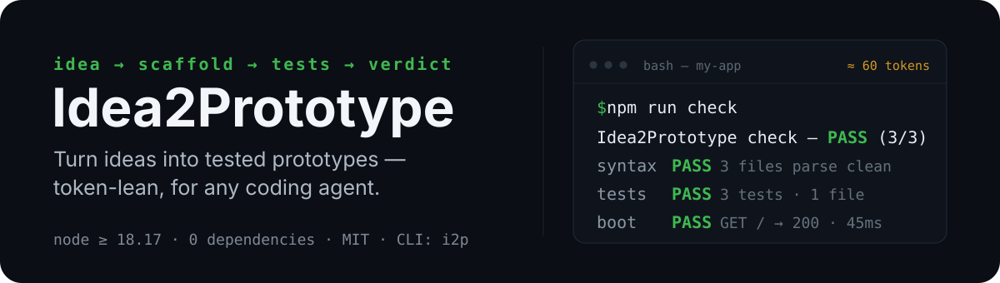
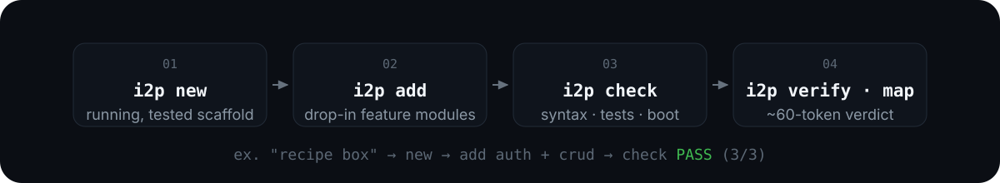

<p align="center">
  
</p>

<p align="center">
  <a href="https://github.com/ahmed-3m/idea2prototype/actions/workflows/ci.yml"></a>
  <a href="https://www.npmjs.com/package/@ahmed-3m/idea2prototype"></a>
  <a href="https://www.npmjs.com/package/@ahmed-3m/idea2prototype"></a>
  <a href="LICENSE"></a>
  <a href="https://nodejs.org/en/about/previous-releases"></a>
  <a href="#design-rules"></a>
</p>

<p align="center"><strong>Turn ideas into tested prototypes — token-lean, for any coding agent.</strong><br>
Zero-dependency scaffolds, feature modules with tests baked in, one-command verification, and a repo map for surgical context. Ships as an npm CLI (<code>i2p</code>) and a <a href="https://z.ai">ZCode</a> plugin; works with any agent that can run a shell (Claude Code, Cline, OpenHands, Cursor, …).</p>

**Status:** v1.0.1 · actively maintained · 1.x — the check/verify contract and template shapes are stable; new capabilities arrive as `add` modules.

> **Idea still fuzzy?** Start one stage earlier with [brainstorm2idea](https://github.com/ahmed-3m/brainstorm2idea) — a Socratic dialogue turns raw thought into a machine-linted `brief.md`, then hands off directly into `i2p new`.

## Why

Watch any coding agent build "a small app" from scratch and you'll see the same token sinks:

1. **Boilerplate emission.** The model writes 15–40 files of config, server plumbing, and test harness — 10–30k output tokens for code a template already contains.
2. **Log ingestion.** Every build/test iteration dumps 5–20k tokens of raw output into context to find the one failing assertion.
3. **Context sprawl.** The agent opens file after file to learn the codebase.

Idea2Prototype moves all three to deterministic code: `new` scaffolds a running, tested project for ~0 tokens, `check` distills syntax + tests + a live boot probe into ~60 tokens, and `map` gives a LOC-and-exports overview instead of file dumps.

| Cost per prototype | Without | With |
|---|---|---|
| Scaffold (~15 files) | ~10–30k output tokens | ~0 (deterministic copy) |
| Feedback per edit | raw logs, 5–20k tokens | verdict, ~60 tokens |
| "Does it actually boot?" | agent guesses / reads logs | boot probe, 1 line |
| Learning the codebase | open everything | `map` (~15 lines) |

## How it works

<p align="center">
  
</p>

The whole point is the verdict. An agent building a prototype should **never generate boilerplate it didn't need to, and never read logs it didn't need to**:

```
$ npm run check

Idea2Prototype check — PASS (3/3 passed)
  syntax  PASS  3 files parse clean (2 server + 1 frontend)
  tests   PASS  3 tests passed (1 files)
  boot    PASS  GET /api/health -> 200, GET / -> 200 in 45ms
```

The syntax step covers server code (`node --check`) and every `.js` under `public/`, recursively (parsed as both ESM and classic script — only code broken in both modes fails). The tests step runs the scaffold's own `node:test` suite; the boot step starts the real server and probes it over HTTP.

## Commands

| Command | What it does |
|---|---|
| `i2p new <dir> --template web\|api\|cli\|worker\|library` | scaffold a running, tested project (zero deps) |
| `i2p add api-crud --resource todos` | JSON-file CRUD resource + roundtrip tests |
| `i2p add auth-local` | accounts: register/login/logout/me — scrypt + HMAC-signed cookies + `requireAuth` |
| `i2p add upload` | multipart file uploads + fetch-back endpoint + tests |
| `i2p add rate-limit` | per-key fixed-window limiter: 429 + `Retry-After` + `X-RateLimit-*` headers |
| `i2p add cors` | CORS wrapper: preflight answers + `access-control-*` headers, origin allowlists |
| `i2p add sse` | Server-Sent Events stream: `GET /api/events`, `text/event-stream` + heartbeats |
| `i2p add worker-jobs` | persistent background job queue: `enqueue`/`list`/`registerHandler`, `data/jobs.json`, 3 attempts |
| `i2p check [--json]` | syntax + tests + boot, compact verdict (also `npm run check`) |
| `i2p verify [dir] [--json]` | same verdict on ANY Node project — judge mode |
| `i2p map [dir] [--json]` | repo map: paths + LOC + exports |

Templates: `web` (static frontend + health + auto-loading routes), `api` (JSON API + route manifest), `cli` (arg-parsed tool), `worker` (persistent job queue with retries), `library` (importable module: `createStore` + `memoAsync`). All Node >= 18.17, built-in `node:test`, zero installs — ever.

**JSON stores are single-writer.** Every `data/*.json` store is an in-memory list persisted on write by ONE server process — run two servers on the same project dir and each will clobber the other's acknowledged writes on its next persist (last writer wins the whole file). A store that fails to parse on first read is never silently wiped: it is quarantined as `data/<name>.json.corrupt-<timestamp>` (the original bytes are preserved for recovery) and the process starts empty with a loud stderr note. `auth-local` sessions are stateless HMAC tokens — logout clears the browser cookie only; a copied token stays valid until it expires.

## Install

The engine itself is one Node file with zero dependencies — any agent that can run a shell can use it via `npx` (see [Quickstart](#quickstart)). For agent-native installs, plugin manifests live in [`.claude-plugin/`](.claude-plugin/) and [`.cursor-plugin/`](.cursor-plugin/), and the skill is at [`skills/idea2prototype/SKILL.md`](skills/idea2prototype/SKILL.md):

| Agent | Install |
|---|---|
| Claude Code | `claude plugin marketplace add ahmed-3m/idea2prototype` → `claude plugin install idea2prototype@ahmed-3m` |
| Any agent (Agent Skills standard) | `npx skills add ahmed-3m/idea2prototype` |
| Cursor | via the Cursor marketplace (submitted for listing) or the universal skills command above |
| Cline | `cline skill install ahmed-3m/idea2prototype` (or via marketplace PR) |
| ZCode | see the plugin note in [Quickstart](#quickstart) |

## Quickstart

**Any agent or plain shell — npx straight off npmjs, no clone needed:**

```bash
npx @ahmed-3m/idea2prototype new my-app --template web --name "My App" --idea "recipe box"
cd my-app && npm start          # http://127.0.0.1:3000
npm run check                   # the verdict above
npx @ahmed-3m/idea2prototype add api-crud --resource recipes
npm run check                   # still PASS — now with CRUD tests
```

**From a clean clone** (offline / air-gapped, or pinning the engine alongside the project):

```bash
git clone https://github.com/ahmed-3m/idea2prototype
node idea2prototype/skills/idea2prototype/scripts/idea2prototype.mjs new my-app --template web --name "My App" --idea "recipe box"
cd my-app && npm start          # http://127.0.0.1:3000
node ../idea2prototype/skills/idea2prototype/scripts/idea2prototype.mjs add api-crud --resource recipes
npm run check                   # still PASS — now with CRUD tests
```

Every release publishes `@ahmed-3m/idea2prototype` to npmjs.org — the primary channel — and mirrors it on the GitHub Packages registry under the same name; that registry asks consumers for a token in `.npmrc` even for public packages, so treat it as the mirror. (`npm i -g @ahmed-3m/idea2prototype` gets you the short `i2p` command the table above uses.)

**ZCode plugin:** add this repo's marketplace, install `idea2prototype`, then pick the skill in the composer or use `/proto-new a recipe box with search`.

**Make any agent use it:** copy [`agents/AGENTS.md`](agents/AGENTS.md) (or `agents/CLAUDE.md`) into your project — it teaches the agent the commands and the token-discipline workflow. Point your agent at this README and it has everything it needs.

## Composing features

Features compose by wrapping handlers. `add` generates each feature standalone; connecting them is a small edit to files the tool generated once and now considers yours (`routes/*.mjs`, `tests/*.mjs`). The canonical example — only logged-in users may create posts, author stamped on the item:

```js
// routes/posts.mjs (after `add auth-local` + `add api-crud --resource posts`)
import { requireAuth } from './auth.mjs';

POST: requireAuth(async ({ body, user }) => {
  // ...original handler body...
  const item = { ...body, id, createdAt, author: user.username }; // body first: server-owned fields win
  // ...persist and return [201, item]...
}),
```

The generated CRUD test then needs a session instead of anonymous POSTs — register + login once, pass the cookie on protected calls (unique username per run; `data/users.json` persists). The full worked example, including the session-bootstrap test pattern, lives in the skill's [`SKILL.md`](skills/idea2prototype/SKILL.md) under "Composing features". `rateLimit()` and `cors()` wrap handlers the same way and nest with `requireAuth`.

## How it compares

| | Idea2Prototype | bolt.diy / dyad | OpenHands / Cline |
|---|---|---|---|
| Runs anywhere (any agent, any OS) | ✅ one Node file | browser/app | IDE/agent-specific |
| Zero dependencies | ✅ | ❌ | ❌ |
| Tests included by default | ✅ scaffold + every feature | varies | varies |
| Feedback for agents | ~60-token verdict | UI-first | logs |
| Works offline / air-gapped | ✅ | ❌ | ✅ |

## Benchmarks

`benchmarks/specs.md` is a pre-registered protocol: paired 2-arm design (same agent with vs. without the harness), blind functional judges, a symmetric verifier (`i2p verify`), and hypotheses stated up front. Results land in that file as they're measured — failures included. Ten specs are archived. Specs 1–2 (web app, API) favor the harness (23% fewer hand-written LOC, 2× tests, zero runner-compat failures — the control's from-scratch `npm test` broke on Node 24/Windows); spec 3 (micro-CLI) is an honest loss on speed and LOC — fixed overhead dominates tiny builds — with reliability and function at parity; spec 4 (expense tracker) wrote ~43% fewer hand-written LOC with 3× tests; spec 7 (bookmarks API + tag filter) is the strongest result at ~64%. Across the set the pattern holds: hand-written LOC −10%…−64% on 7 of 8 build-type specs (spec 6 at parity), generated tests 2–3× the control's, full-depth verify against the control's recurring boot-skip — while the from-scratch arm stays faster on several small builds, recorded as such.

## Design rules

1. **Deterministic outside the model, instructions inside.** Anything a template can own, the template owns.
2. **Zero dependencies, forever.** No install step between "scaffolded" and "verified".
3. **Verdicts, not logs.** Failure output is capped at 3 notes so context stays clean.
4. **No destructive operations.** `new` refuses non-empty directories.
5. **Portable core.** One `.mjs` engine; plugin/skill/npm wrappers are sugar.

One deliberate tradeoff: a scaffolded project's `npm run check` invokes the exact engine version that scaffolded it — a clone-scaffolded project pins the sibling engine path, an npx-scaffolded project pins registry coordinates (`npx -y @ahmed-3m/idea2prototype@<version> check`), so a cleared npx cache or a second machine just re-fetches the same version — and older prototypes keep the behavior they were built with (run a newer engine by hand and it reports the drift note). An always-current check remains on the roadmap.

Another boundary worth naming: templates are single-purpose and do not compose with each other — features compose within a template (auth × CRUD, rate-limit, cors, sse, worker-jobs). The one gap this used to leave — a web/api app that also needs background jobs — is closed by `add worker-jobs`, which brings the worker template's persistent queue in as a feature module; anything bigger than that still scaffolds as the primary template with the smaller part hand-built.

## Contributing

New templates and features are exactly two template files + one registry entry — see [CONTRIBUTING.md](CONTRIBUTING.md). The engine suite (`node --test tests/engine.test.mjs tests/consistency.test.mjs`) runs on ubuntu/windows across Node 18/22/24 in CI and must stay green. `AGENTS.md` documents the architecture for humans and coding agents alike.

## License

MIT — see [LICENSE](LICENSE).
